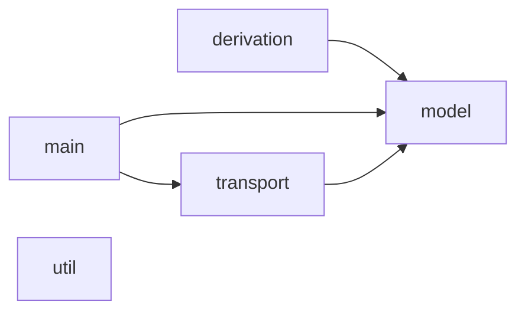
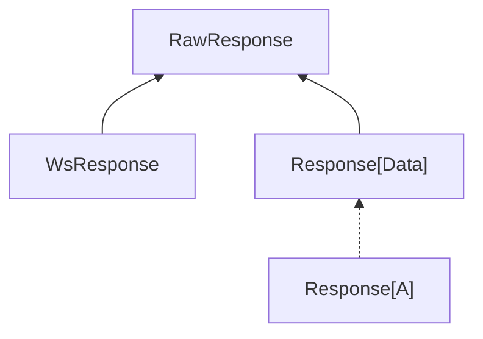

# keg

A small web framework, merging ideas from
[flask](https://flask.palletsprojects.com/en/stable/),
[rocket](https://rocket.rs/) and especially reusing many ideas from
[cask](https://github.com/com-lihaoyi/cask).


```scala
@keg.post("/hello/:n")
def hello(n: Int, req: keg.Request) =
  s"hello ${req.text()}\n" * n

val server = keg.Server(keg.routes())

@main
def main() =
  server.start()
```


```
$ curl "http://localhost:8080/hello/5" -d "alice"
hello alice
hello alice
hello alice
hello alice
hello alice
```


Keg aims to make writing HTTP applications in Scala a breeze. It is designed for
writing full classic web apps or specialized application programming interfaces
(APIs) alike. It includes most features you'd expect in a web server, yet stays
minimal and strives to make development fun. It should feel ergonomic and not
impose how you build your application.

Keg is NOT a full-featured framework, which imposes an application structure,
such as Django or Play! You can use it as a library if you like.

## Feature overview

- [Basics](#basics)
- [Request routing](#request-routing)
- [Reading request data](#reading-request-data)
- [Returning responses](#returning-responses)
- [Configuration traits](#configuration-traits)
- [Managing state and structuring application](#managing-state-and-structuring-application)
- [Error handling](#error-handling)
- [Websockets](#websockets)
- [Cookies, session, and flash data](#cookies-session-and-flash-data)
- [TLS and mTLS](#tls-and-mtls)
- [Raw endpoints](#raw-endpoints)
- [Interceptors](#interceptors)
- [Transports](#transports)
- [Forms](#forms)
- [JSON](#json)
- [Debug mode and live reload](#debug-mode-and-live-reload)

### Basics


A keg application requires two things:
1. a set of routes, which are defined by annotating methods
2. a server, which is created from the routes and listens for incoming requests

```scala
// define routes by annotating methods
@keg.get("/hello")
def hello() =
  s"hello, world!"

@keg.post("/echo")
def echo(req: keg.Request) =
  req.text()

// use the keg.routes() macro to collect all annotated methods into a set of
// routes
val routes: Seq[keg.Route] = keg.routes()

// finally, create a server from the routes
val server: keg.Server = keg.Server(routes)

@main
def main() =
  // start the server to listen for incoming requests
  server.start()

  // not necessary, but this lets you gracefully shut down the server,
  // preventing new requests from being accepted and waiting for existing
  // requests to finish before exiting the application
  sys.addShutdownHook:
    server.stop()
    server.awaitTermination()
```


```
$ curl "http://localhost:8080/hello"
hello, world!
```

```
$ curl "http://localhost:8080/echo" -d "hello"
hello
```


By default the server listens on port 8080. You can change this by setting
the `listeners` parameter when creating the server.

```scala
val serverWithConfig = keg.Server(
  routes,
  listeners = Seq(
    keg.Listener.Http("::", 8081),
    keg.Listener.Http("::1", 8082), // you can even listen on multiple ports!
    keg.Listener.Https("::", 8443, key = keyPath, cert = certPath) // see the TLS example for more info on HTTPS
  )
)
```


### Request routing


#### Defining routes

A method annotated with `@keg.get` will be called when a GET request to the
specified path is made.

```scala
@keg.get("/hello")
def hello() = "Hello, world!"
```

```
$ curl "http://localhost:8080/hello"
Hello, world!
```

Keg has an annotation for each common HTTP method:

```scala
@keg.post("/post")
def post() = "This is a POST request"
@keg.put("/put")
def put() = "This is a PUT request"
@keg.delete("/delete")
def delete() = "This is a DELETE request"
```

```
$ curl "http://localhost:8080/post" -X POST
This is a POST request
```

```
$ curl "http://localhost:8080/put" -X PUT
This is a PUT request
```

```
$ curl "http://localhost:8080/delete" -X DELETE
This is a DELETE request
```

However, you can also use the more general `@keg.request` annotation to
specify the path and method(s) directly

```scala
@keg.request("/generic", methods = Seq("GET", "POST", "custommethod"))
def foo2() = "bar"
```

```
$ curl "http://localhost:8080/generic" -X custommethod
bar
```

#### Path parameters

Paths can contain parameters, which are specified by prefixing a path segment
with `:`. The parameter value will be passed as an argument to the method,
and automatically converted to the appropriate type (e.g. Int, String, etc.).

```scala
@keg.get("/hello/:name")
def helloName(name: String) =
  s"Hello, $name!"
```

```
$ curl "http://localhost:8080/hello/alice"
Hello, alice!
```


```scala
@keg.get("/add/:x/:y")
def add(x: Int, y: Int) =
  s"$x + $y = ${x + y}"
```

```
$ curl "http://localhost:8080/add/3/4"
3 + 4 = 7
```
Invalid input will result in a 400 Bad Request response without us having to
write any error handling code in the method itself!

```
$ curl "http://localhost:8080/add/3/foo" -i
HTTP/1.1 400 Bad Request
...
Parameter 'y' is invalid: Invalid integer in path
...
```

Creating custom types for path parameters is also easy. Just define an
instance of `keg.FromPath` for your type, and Keg will automatically use it
to parse path parameters of that type. For example, if we have a `UserId` type:

```scala
case class UserId(value: String)
// we can define a `keg.FromPath` instance for it like this:
object UserId:
  given keg.FromPath[UserId] with
    def fromPath(segment: String, ctx: Unit) =
      if segment.startsWith("abc") then
        keg.Result.Continue(UserId(segment))
      else
        keg.Result.Abort(400, "User ID must start with 'abc'")
// and then we can use `UserId` as a parameter type in our endpoint:
@keg.get("/users/:id")
def getUser(id: UserId) =
  s"User ID: ${id.value}"
```

```
$ curl "http://localhost:8080/users/abc123"
User ID: abc123
```

```
$ curl "http://localhost:8080/users/xyz123" -i
HTTP/1.1 400 Bad Request
...
Parameter 'id' is invalid: User ID must start with 'abc'
```

#### Wildcard parameters

You can also define wildcard parameters that match the rest of the path using
`*`. For example, the following endpoint will match any path that starts with
`/files/`:

```scala
@keg.get("/files/*")
def files(req: keg.Request) =
  // accessing wildcard parameters requires using `keg.Request` instead of typed
  // method parameters; this will be discussed in more detail in the next
  // section
  s"Requested file: ${req.remainingPathSegments.mkString("/")}"
```

```
$ curl "http://localhost:8080/files/path/to/file.txt"
Requested file: path/to/file.txt
```

#### Overlapping routes

Keg uses a greedy trie-based router, which does lookups in linear time to
number of path segments. The router has the following characteristics:
- static paths are always preferred
- followed by dynamic paths
- in case no match is found, the closest wildcard is used

It is possible to have a static and dynamic route overlap, in which case the
static route will take precedence over the dynamic one. This allows you to
build applications with "vanity" URLs, for example a GitHub-style web
interface for user profiles:

```scala
@keg.get("/:username")
def userProfile(username: String) =
  s"User profile for ${username}"
@keg.get("/settings")
def settings() =
  "User settings"
@keg.get("/*")
def notfound() =
  "Not found"
```

```
$ curl "http://localhost:8080/alice"
User profile for alice
```

```
$ curl "http://localhost:8080/settings"
User settings
```

```
$ curl "http://localhost:8080/alice/foo"
Not found
```
If you use this pattern, it is up to you to ensure that no users can register
with a username that conflicts with one of your static routes (e.g.
"settings" in the example above).


### Reading request data


You can access the HTTP request by adding a parameter of type `keg.Request`
to the method:

```scala
@keg.post("/req")
def req(req: keg.Request) =
  s"Method: ${req.method}, Path: ${req.path}, Body: ${req.text()}"
```

```
$ curl "http://localhost:8080/req" -d "hello"
Method: POST, Path: /req, Body: hello
```

The `keg.Request` class gives you access to all parts of an HTTP request,
including headers, query parameters, etc. It's technically enough to
implement an endpoint, but it's usually more convenient to work with
higher-level abstractions that do validation and parsing for you.

Keg has built-in support for parsing many common types, including:
- form data (url-encoded and multipart, including file uploads)
- JSON (using ujson)


```scala
@keg.post("/form")
def form(data: keg.FormData) =
  data.fields.toString

@keg.post("/json")
def json(data: ujson.Obj) =
  data

@keg.post("/json-any")
def jsonAny(data: ujson.Value) =
  data
```


```
$ curl "http://localhost:8080/form" -d "name=alice&age=42"
Map(name -> alice, age -> 42)
```


```
$ curl "http://localhost:8080/json" -d "{\"name\": \"alice\", \"age\": 42}"
{"name":"alice","age":42}
```

Notice how invalid input results in a 400 Bad Request response without us
having to write any error handling code in the method itself!

```
$ curl "http://localhost:8080/json" -d "[1, 2, 3] -i"
Bad Request
```


```
$ curl "http://localhost:8080/json-any" -d "[1, 2, 3]"
[1,2,3]
```


### Returning responses


Keg will automatically serialize the return value of your endpoint to the
appropriate content type based on its type. For example, a String will be
returned as text, a ujson.Obj will be returned as JSON, and an Array[Byte]
will be returned as binary.

```scala
@keg.get("/text")
def text() =
  "hello world"
```

```
$ curl "http://localhost:8080/text" -i
...
Content-Type: text/plain; charset=UTF-8
...
hello world
```


```scala
@keg.get("/json")
def json() =
  ujson.Obj("name" -> "alice", "age" -> 42)
```

```
$ curl "http://localhost:8080/json" -i
...
Content-Type: application/json; charset=UTF-8
...
{"name":"alice","age":42}
```


```scala
@keg.get("/binary")
def binary() =
  Array[Byte](1, 2, 3, 4, 5)
```

```
$ curl "http://localhost:8080/binary" -i
...
Content-Type: application/octet-stream
...
```

You can also return a `keg.Response` directly if you want more control over
the response, such as setting custom headers or status codes. For example,
the following endpoint returns a JSON object with a custom status code and
header:


```scala
// override content type
@keg.get("/custom")
def custom() =
  keg.Response(
    ujson.Obj("name" -> "alice", "age" -> 42),
    status = 299,
    headers = Seq("X-Custom-Header" -> "Hello")
  )
```

```
$ curl "http://localhost:8080/custom" -i
HTTP/1.1 299 Unknown
...
X-Custom-Header: Hello
...
{"name":"alice","age":42}
```

Keg integrates with the [geny](https://github.com/com-lihaoyi/geny)
ecosystem, so you can return any geny.Writable as a response body, and Keg
will stream it to the client.
For example, using scalatags! (note that keg itself does not depend on scalatags)

```scala
@keg.get("/html")
def index() =
  import scalatags.Text.all as h
  import h.given
  import scalatags.Text.tags2.title

  h.doctype("html")(
    h.html(
      h.head(
        title("Hello")
      ),
      h.body(
        h.h1("Hello, world!")
      )
    )
  )
```

```
$ curl "http://localhost:8080/html" -i
...
Content-Type: text/html
...
<!DOCTYPE html><html><head><title>Hello</title></head><body><h1>Hello, world!</h1></body></html>
```

You can also define your own custom response types by implementing the
`keg.ToResponse` trait for your type. For example, if we have a `HashedBlob` type:

```scala
case class HashedBlob(content: String)
// we can define a `keg.ToResponse` instance for it like this:
object HashedBlob:
  given keg.default.ToResponse[HashedBlob] with
    def toResponse(blob: HashedBlob, ctx: keg.default.Context) =
      keg.Response(
        ujson.Obj("content" -> blob.content),
        headers = Seq("X-Hash" -> blob.content.hashCode.toString)
      )
// and then we can return `HashedBlob` directly from our endpoint:
@keg.get("/blob")
def hashedBlob() =
  HashedBlob("alice")
```

```
$ curl "http://localhost:8080/blob" -i
HTTP/1.1 200 OK
...
X-Hash: 92903040
...
{"content":"alice"}
```

#### Aborting with an error response

If you want to return an error response from your endpoint, you have two
options:

- either build a regular `keg.Response` with the desired status code and body
  and return it directly, or
- throw a `keg.AbortException` with the desired status code and message

The former puts you in control of the entire response body, while the latter
pushes error handling to a centralized error handler (which you can
customize, see the Errors section).

```scala
@keg.get("/check/:x")
def abort(x: Int) =
  if x < 0 then
    keg.abort(400, "x must be non-negative")
  else
    s"x is $x"
```

```
$ curl "http://localhost:8080/check/5"
x is 5
```

```
$ curl "http://localhost:8080/check/-1" -i
HTTP/1.1 400 Bad Request
...
```


### Configuration traits


By default, keg's `FromRequest` and `ToResponse` type class instances are
defined as `given`s in companion objects. This works well for types you own,
but falls apart for external types (from third-party libraries or the
standard library) whose companion objects you cannot modify.

The *configuration traits* pattern solves this by collecting all instances
in a single object that extends `keg.derivation.Api`. Because `FromRequest`
is path-dependent on that object, instances defined inside it are scoped to
it and do not require touching the types' companion objects.

Endpoints are then annotated with `@app.get` / `@app.post` (instead of the
global `@keg.get` / `@keg.post`) so the macro looks up `FromRequest`
instances in the right scope.

#### Example

Suppose `Pagination` comes from an external library. We cannot add a
`given FromRequest[Pagination]` to its companion object, so we define it inside
our own `app` object instead. All other givens for external types go there
too, giving us one central place to look.

```scala
case class Pagination(page: Int, pageSize: Int) // imagine this is from a third-party library

object app extends keg.Api:

  // Defined here rather than in Pagination's companion object, which we don't control
  given FromRequest[Pagination] with
    def fromRequest(req: keg.Request, ctx: Context): keg.Result[Pagination] =
      val page = req.params.get("page").flatMap(_.toIntOption).getOrElse(1)
      val pageSize = req.params.get("pageSize").flatMap(_.toIntOption).getOrElse(10)
      keg.Result.Continue(Pagination(page, pageSize))

// Use `@app.post`, not `@keg.post`, so the macro resolves `FromRequest` inside `app`
@app.post("/profile")
def profile(pagination: Pagination) =
  s"Page: ${pagination.page}, Page Size: ${pagination.pageSize}\n"

val routes = keg.routes()

@main
def main() =
  val server = keg.Server(routes)
  server.start()

  sys.addShutdownHook:
    server.stop()
    server.awaitTermination()
```

```
$ curl "http://localhost:8080/profile?page=2&pageSize=5" -X POST
Page: 2, Page Size: 5
```


### Managing state and structuring application


State management and dependency injection is often a key part of web
frameworks that is prone to scope creep.

Keg takes on a very limited role in state management: essentially, it only
focuses on mechanisms to inject request-scoped state. Application state is
not managed by keg, and users are free to use whatever they wish, be it plain
classes with parameters or anything else.

The recommended way to inject request-scoped state is by using the
configuration-trait pattern described earlier, but where the configuration
trait contains state.

For example, a typical use case is requiring a logged-in user: the
`FromRequest[User]` instance looks up the session and either yields the user
or short-circuits the request with a `401 Unauthorized` — similar to [request
guards in Rocket](https://rocket.rs/guide/v0.5/requests/#request-guards).


```scala
case class User(name: String)

object app extends keg.Api:
  // in a real application, this would likely be a database or an external service
  val userDb = collection.mutable.Map[String, User]("alice" -> User("Alice"))

  given FromRequest[User] with
    def fromRequest(req: keg.Request, ctx: Context): keg.Result[User] =
      userDb.get(req.params.get("username").getOrElse("")) match
        case Some(user) => keg.Result.Continue(user)
        case None       => keg.Result.Respond(keg.Response("Unauthorized\n", 401))

@app.post("/profile")
def profile(user: User) =
  s"Hello, ${user.name}!\n"

val routes = keg.routes()

@main
def main() =
  val server = keg.Server(routes)
  server.start()
```

```
$ curl "http://localhost:8080/profile?username=alice" -X POST
Hello, Alice!
```

```
$ curl "http://localhost:8080/profile?username=nobody" -X POST -i
HTTP/1.1 401 Unauthorized
...
Unauthorized
```

Note that you are not limited to static objects! You can make your whole
application as modular as you like, using plain classes for dependency
injection.

```scala
class UserService:
  val userDb = collection.mutable.Map[String, User]("alice" -> User("Alice"))

class App(userService: UserService) extends keg.Api:
  given FromRequest[User] with
    def fromRequest(req: keg.Request, ctx: Context): keg.Result[User] =
      userService.userDb.get(req.params.get("username").getOrElse("")) match
        case Some(user) => keg.Result.Continue(user)
        case None       => keg.Result.Respond(keg.Response("Unauthorized\n", 401))

class Routes(app: App):

  @app.post("/profile")
  def profile(user: User) =
    s"Hello, ${user.name}!\n"

  val routes = keg.routes()

def main2() =
  val userService = UserService()
  val app = App(userService)
  val routes = Routes(app).routes
  val server = keg.Server(routes)
  server.start()
```


### Error handling


Error handling is also done with annotations. A method annotated with
`@keg.error()` will be called whenever an exception is thrown while
processing a request. Such as method is known as the *recovery*.

A recovery may only take arguments of the following types:
- `keg.Request`: the request that caused the error
- `Option[keg.Endpoint]`: the endpoint that generated the error, if the error
  originated in an endpoint
- `Throwable`: the exception that was thrown

By convention, `keg.AbortException` is thrown by endpoints when the error
represents something that has a status code. The message is intended for
debugging, and shouldn't be shown to the user.

A recovery itself should not throw! Any exceptions from a recovery will
bubble up to the HTTP transport, which may simply terminate the HTTP
connection or produce non-overridable error messages of its own.


```scala
@keg.error()
def errorHandler(
  req: keg.Request,
  ep: Option[keg.Endpoint],
  ex: Throwable
): keg.RawResponse =
  // In this example we include the messages in the response. In a real app,
  // you'd usually hide the message, or use an application-specific exception
  // type when you actually want to include the message in the response body.
  ex match
    case keg.AbortException(code, message) =>
      keg.Response(
        s"the endpoint ${ep.map(_.path).getOrElse("none")} rejected the request: ${message}\n",
        code
      )
    case _ =>
      keg.Response(
        s"an exception was thrown while processing the request: ${ex.getMessage}\n",
        500
      )

@keg.get("/fail")
def fail(): keg.Response[keg.Data] =
  throw new RuntimeException("something went wrong")

@keg.get("/reject")
def reject(): keg.Response[keg.Data] =
  keg.abort(400, "request rejected by endpoint")
```

```
$ curl "http://localhost:8080/fail" -i
HTTP/1.1 500 Internal Server Error
...
an exception was thrown while processing the request: something went wrong
```

```
$ curl "http://localhost:8080/reject" -i
HTTP/1.1 400 Bad Request
...
the endpoint /reject rejected the request: request rejected by endpoint
```


By default, a request to a non-existing endpoint will throw a 404 abort
exception. While you *can* define a recovery which catches a 404, you could
also have a fallback endpoint:
nippedt:start
nippet:end

```
$ curl "http://localhost:8080/doesnotexist"
custom not found: /doesnotexist
```


### Websockets


Websocket support is more-or-less copied directly from cask.


```scala
@keg.get("/hello/:x")
def hello(x: String): keg.RawResponse =
  if x != "secret" then
    // you can also return a normal HTTP response in a websocket handler if you
    // want to
    keg.Response("Unauthorized", status = 401)
  else
    keg.WsResponse: channel =>
      channel.send(keg.Ws.Text("hello world"))

      keg.WsActor:
        case keg.Ws.Text(txt) =>
          channel.send(keg.Ws.Text(s"echo: $txt"))
        case keg.Ws.Close(code, reason) =>
          println(s"Received close: $code - $reason")
        case keg.Ws.ChannelClosed() =>
          println("WebSocket channel closed")
```

One thing which is different about keg however, is that not `actorContext` is
needed to create a `WsActor`. Keg does this by injecting a context with a
context function into `keg.WsResponse(ctx ?=> channel => actor)`.


### Cookies, session, and flash data


Cookies are an essential part of web development, allowing you to store data
on the client and have it sent back to the server. Keg has built-in support
for working with cookies.

```scala
@keg.get("/get")
def hello(req: keg.Request) =
  val savedData: Option[keg.Cookie] = req.cookies.get("data")
  savedData match
    case Some(cookie) =>
      s"hello again! you previously saved: ${cookie.value}\n"
    case None =>
      s"hello, nice to meet you! you haven't saved anything yet.\n"

@keg.post("/post")
def save(req: keg.Request) =
  val data = req.text()
  // set a cookie with the saved data; this will be sent back to the client in
  // the response, and the client will send it back in future requests
  keg.Response(
    s"saved: $data\n",
    cookies = Seq(keg.Cookie("data", data, path = "/"))
  )
```

```
$ curl "http://localhost:8080/get"
hello, nice to meet you! you haven't saved anything yet.
```

```
$ curl "http://localhost:8080/post" -d "my-secret-data" --cookie-jar /tmp/cookies.txt
saved: my-secret-data
```

```
$ curl "http://localhost:8080/get" --cookie /tmp/cookies.txt
hello again! you previously saved: my-secret-data
```

A common pattern is to use cookies to store session data on the client,
essentially long-lived data that is associated with a particular user.
Instead of wrangling raw cookies directly for this, Keg provides a convenient
`session` abstraction that allows you to store and access key-value pairs.

> [!NOTE]
>
> Session data is signed by the server, but not encrypted. This means that
> someone can't forge key-value pairs sent to the server, but they can read
> them if they have access to the cookie.

```scala
@keg.get("/session")
def session(req: keg.Request) =
  val data: Map[String, String] = req.session
  val userId = data.getOrElse("userId", "unknown")
  s"your user ID is: $userId\n"

@keg.post("/login")
def login(req: keg.Request) =
  // in a real application, you would verify the user's credentials and generate
  // a unique user ID; for this example, we'll just use a fixed user ID
  val userId = "user-123"
  // set the user ID in the session; this will be stored server-side and associated with the client via a session cookie
  keg.Response(
    s"logged in as user ID: $userId\n",
    session = Map("userId" -> userId)
  )
```

```
$ curl "http://localhost:8080/session"
your user ID is: unknown
```

```
$ curl "http://localhost:8080/login" -X POST --cookie-jar /tmp/cookies.txt
logged in as user ID: user-123
```

```
$ curl "http://localhost:8080/session" --cookie /tmp/cookies.txt
your user ID is: user-123
```

A flash is a special type of session data that is only available for the next
request; after that, it is automatically cleared. This is useful for storing
temporary messages that you want to show to the user after a redirect, as is
common in "classic" web applications. Keg has built-in support for flash
messages as well, which work similarly to sessions but are automatically
cleared after the next request.

```scala
@keg.get("/flash")
def flash(req: keg.Request) =
  val message: Option[String] = req.flash.get("message")
  message match
    case Some(msg) =>
      s"flash message: $msg\n"
    case None =>
      s"no flash message\n"

@keg.get("/set-flash")
def setFlash() =
  // set a flash message; this will be stored server-side and associated with
  // the client via a flash cookie, but it will only be available for the next
  // request; after that, it will be automatically cleared
  keg.Response(
    "flash message set\n",
    status = 302,
    flash = Map("message" -> "this is a flash message"),
    headers = Seq("location" -> "/flash") // typically you would set a flash message and then redirect the client to another page where the message will be displayed
  )
```

```
$ curl "http://localhost:8080/flash"
no flash message
```

```
$ curl "http://localhost:8080/set-flash" --cookie-jar /tmp/cookies.txt --cookie /tmp/cookies.txt --location
flash message: this is a flash message
```

```
$ curl "http://localhost:8080/flash" --cookie /tmp/cookies.txt
no flash message
```


### TLS and mTLS


Support for HTTPS is built in. You just need to provide a certificate and key
as standard PEM files, and configure the server to listen for HTTPS requests.

```scala
@keg.get("/hello")
def hello() =
  "hello world\n"

val server = keg.Server(
  keg.routes(),
  listeners = Seq(
    keg.Listener.Https(
      host = "::",
      port = 8443,
      key = Path.of("creds/server.key"),
      cert = Path.of("creds/server.crt")
    )
  )
)
```

```
$ curl "https://localhost:8443/hello" --cacert creds/server-ca.crt
hello world
```
Changes to files are picked up automatically on each new connection. This
means that that if a certificate is updated (by an automated process for
example), the new certificate will be seamlessly used and no restart of the
server is required.

It's also possible to use a client certificate for authentication. Add the
`clientCa` parameter:

```scala
val serverWithClientAuth = keg.Server(
  keg.routes(),
  listeners = Seq(
    keg.Listener.Https(
      host = "::",
      port = 8443,
      key = Path.of("creds/server.key"),
      cert = Path.of("creds/server.crt"),
      clientCa = Some(Path.of("creds/client-ca.crt"))
    )
  )
)

// You can then access the client certificate in your endpoints.
@keg.get("/whoami")
def whoami(req: keg.Request) =
  req.clientCertificate match
    case Some(cert) => s"Your client certificate subject is: ${cert.subject}\n"
    case None => "No client certificate provided\n"
```

```
$ curl "https://localhost:8443/whoami" --cacert creds/server-ca.crt --cert creds/client.crt --key creds/client.key
Your client certificate subject is: CN=client
```

> [!IMPORTANT]
>
> **It is up to your application to check for the presence of a client
> certificate**, keg will still accept requests without a client certificate.
> It only guarantees that if `request.clientCertificate` is `Some(cert)`
> that it has been signed by the specified CA and not expired.


### Raw endpoints


Keg is structured as a layered framework. At the very top, you write your
application code by annotating methods with `@keg.get`, `@keg.post`, etc.
This is the most convenient way to write your application, but isn't what's
actually happening under the hood. Keg actually uses a different
representation for your endpoints. The annotations are just a thin layer that
generates the underlying data structures for you.

If you want more control, you can skip the annotations and write the
underlying data structures directly. This is more verbose, but can be useful
for quickly writing a simple server or advanced use cases, such as building
endpoints programmatically.


```scala
val routes = Seq(
  keg.Endpoint(
    path = "/",
    methods = Seq("GET"),
    invoke = _ =>
      keg.Response("Hello, World!", 200)
  ),
  keg.Endpoint(
    path = "/echo",
    methods = Seq("POST"),
    invoke = req =>
      val body = new String(req.body().readAllBytes(), "UTF-8")
      keg.Response(s"Echo: $body", 200)
  ),
  keg.Endpoint(
    path = "/fail",
    invoke = _ =>
      keg.abort(418, "I'm a teapot")
  ),
  keg.Endpoint(
    path = "/*",
    invoke = (req) =>
      keg.Response("Custom 404 Not Found", 404)
  ),
  keg.Recovery(
    invoke = (req, err, ep) =>
      keg.Response(s"Custom error page: ${err}", 500)
  )
)

val server = keg.Server(routes)
```


### Interceptors


An *interceptor* is a component that sits between the server and your
endpoint handlers. It is called for every request that matches an endpoint,
and can:
- perform side effects before or after calling the handler (e.g. logging)
- modify the request before passing it to the handler
- modify the response before returning it to the client
- short-circuit the request and return a response directly (e.g. auth checks)

Interceptors are a good fit for cross-cutting concerns that are *opaque* to
the endpoint handlers — things they don't need to know about, such as
logging, metrics or compression. For concerns that the handler *does* need to
know about (e.g. the currently logged-in user), prefer a custom `FromRequest`
instance instead.

#### Logging

The simplest kind of interceptor just runs side effects around the handler.
Here we print a line before and after every request:

```scala
object LoggingInterceptor extends keg.Interceptor:
  def intercept(
    request: keg.Request,
    endpoint: keg.Endpoint,
    next: keg.Request => keg.RawResponse
  ): keg.RawResponse =
    println(s"--> ${request.method} ${request.path}")
    val response = next(request)
    response match
      case r: keg.Response[?] =>
        println(s"<-- ${r.status}")
      case _ =>
    response
```

#### Request/response modification

Interceptors can also transform the request before it reaches the handler, or
wrap the response on the way back out. The following interceptor adds
transparent gzip compression: it decompresses a gzip-encoded request body
(if present) and compresses the response body when the client signals that it
accepts gzip encoding.

```scala
import java.util.zip.{GZIPInputStream, GZIPOutputStream}

object GzipInterceptor extends keg.Interceptor:
  def intercept(
    request: keg.Request,
    endpoint: keg.Endpoint,
    next: keg.Request => keg.RawResponse
  ): keg.RawResponse =
    // Decompress request body if Content-Encoding: gzip
    val req =
      if request.headers.get("content-encoding").exists(_.equalsIgnoreCase("gzip")) then
        request.copy(getBody = () => GZIPInputStream(request.getBody()))
      else
        request

    val response = next(req)

    // Compress response if client accepts gzip
    val clientAcceptsGzip = request.headers
      .getAll("accept-encoding")
      .flatMap(_.split(','))
      .map(_.trim.toLowerCase)
      .exists(_ == "gzip")

    if !clientAcceptsGzip then response
    else
      response match
        case resp: keg.Response[keg.model.Data] =>
          val originalData = resp.data
          val compressedData = new keg.model.Data:
            def write(out: java.io.OutputStream): Unit =
              val gz = GZIPOutputStream(out)
              originalData.write(gz)
              gz.finish()
            def headers: Seq[(String, String)] = originalData.headers
            def contentLength: Option[Long] = None
          resp.copy(
            data = compressedData,
            headers = resp.headers :+ ("Content-Encoding" -> "gzip")
          )
        case ws: keg.model.WsResponse => ws
```

#### Short-circuiting

An interceptor can also return a response *without* calling `next`, which
completely bypasses the handler. This is useful for things like access
control. The example below rejects any request that doesn't carry a specific
header:

```scala
case class ApiKeyInterceptor(validKey: String) extends keg.Interceptor:
  def intercept(
    request: keg.Request,
    endpoint: keg.Endpoint,
    next: keg.Request => keg.RawResponse
  ): keg.RawResponse =
    request.headers.get("x-api-key") match
      case Some(key) if key == validKey =>
        next(request)
      case _ =>
        keg.Response("Unauthorized", 401)
```

#### Using interceptors

Interceptors are passed to `keg.Server` via the `interceptors` parameter.
They are applied in order, so the first interceptor in the list is the
outermost one (it runs first on the way in and last on the way out).

```scala
@keg.get("/hello")
def hello(req: keg.Request) =
  s"hello, ${req.headers.getOrElse("x-name", "world")}!\n"

val routes = keg.routes()

@main
def main() =
  val server = keg.Server(
    routes,
    interceptors = Seq(
      LoggingInterceptor,
      GzipInterceptor,
      ApiKeyInterceptor("secret")
    )
  )
  server.start()
```

```
$ curl "http://localhost:8080/hello" -H "x-api-key: secret" -H "x-name: alice"
hello, alice!
```

```
$ curl "http://localhost:8080/hello" -i
HTTP/1.1 401 Unauthorized
...
Unauthorized
```

```
$ curl "http://localhost:8080/hello" --compressed -H "x-api-key: secret"
hello, world!
```


### Transports

Keg itself does not implement the actual handling of network requests. Instead,
it factors those out to so-called *transports*. A transport is the subsystem
which handles the low-level reading and writing of network streams which make up
the HTTP protocol.

Keg is structured in such a way that the transport for a keg server can be
swapped out. Or, put differently, you can essentially think of keg as being a
large wrapper around a transport, which does that actual request handling.

Out-of-the-box, keg comes with two transports:

1. one based on the Undertow webserver. This is a very stable and
   feature-complete webserver for Java. Unfortunately however, it does not work
   with ScalaNative and also has issues when built as a GraalVM native image.

   This transport is the **default when using keg on the JVM**.

1. one based on an experimental pure-scala HTTP server written from scratch.
   This webserver is minimal, doesn't implement advanced features such as
   websockets, and is probably not spec-compliant (web clients should be
   tolerant). It is however available under scala native!

   This transport is the **default when using keg with scala native**.

Here is a more detailed comparison of both transports:

| feature  | UndertowTransport | UhttpTransport |
|----------|-------------------|----------------|
| HTTP/1.1 | yes               | yes            |
| HTTP/2.0 | yes               | no             |
| HTTPS    | yes               | only on JVM    |
| websockets | yes             | no             |
| JVM      | yes               | yes            |
| native   | no                | yes            |

You can switch out the transport simply by passing it as an argument to
`keg.Server`. For example, here we explicitly tell keg to use the Uhttp server,
regardless of platform:

```scala
keg.Server(
  ...,
  transportBuilder = keg.transport.uhttp.UhttpTransport(_, _)
)
```

You can also implement your own transport if you like. Take a look at the
[Transport](keg/transport/Transport.scala) trait to see what you need.

### Forms


Keg supports two kinds of form data:

- **URL-encoded** (`application/x-www-form-urlencoded`): the default for
  HTML forms without file inputs.
- **Multipart** (`multipart/form-data`): used when forms include file
  uploads.

#### URL-encoded forms

Use `keg.FormData` to read URL-encoded submissions. Fields are accessible
by name via `form.fields`. Field data is capped at 30 KB by default; larger
submissions are rejected with `413 Content Too Large`.

```scala
@keg.post("/greet")
def greet(form: keg.FormData) =
  val name = form.fields.getOrElse("name", "world")
  s"Hello, $name!\n"
```

```
$ curl http://localhost:8080/greet -d "name=Alice"
Hello, Alice!
```

#### Multipart forms and file uploads

Use `keg.UploadFormData` to handle `multipart/form-data` requests. Plain
fields are in `form.fields`; uploaded files are in `form.files`. Each file
entry carries the original filename and a `java.nio.file.Path` pointing to a
temporary copy on disk — keg cleans it up automatically when the value is
garbage-collected.

The default limits are 30 KB for plain fields and 100 MB per uploaded file;
submissions that exceed these limits are rejected with `413 Content Too
Large`.

```scala
@keg.post("/upload")
def upload(form: keg.UploadFormData) =
  val label = form.fields.getOrElse("label", "file")
  val file = form.files("content")
  val bytes = java.nio.file.Files.readAllBytes(file.path)
  s"$label (${file.filename}): ${new String(bytes)}\n"
```

```
$ printf "hello keg" | curl http://localhost:8080/upload  -F "label=message" -F "content=@-;filename=note.txt"
message (note.txt): hello keg
```


### JSON


Keg integrates with [upickle](https://com-lihaoyi.github.io/upickle/) for
JSON support, covering both raw and typed access.

#### Raw JSON

Parameters of type `ujson.Value`, `ujson.Obj`, or `ujson.Arr` are parsed
from the request body automatically. You can return them directly as
responses — keg serializes them back to JSON and sets `Content-Type:
application/json`.

```scala
@keg.post("/echo")
def echo(body: ujson.Value) =
  body
```

```
$ curl http://localhost:8080/echo -d '{"name":"Alice","scores":[1,2,3]}'
{"name":"Alice","scores":[1,2,3]}
```

#### Typed JSON with `derives ReadWriter`

For typed access, derive `upickle.default.ReadWriter` on a case class. Keg
picks up the generated instances automatically — the case class can be used
as an endpoint parameter (request parsing) and as a return type (response
serialization) with no additional boilerplate:

```scala
case class Item(name: String, count: Int) derives upickle.default.ReadWriter

@keg.post("/double")
def double(item: Item) =
  item.copy(count = item.count * 2)
```

```
$ curl http://localhost:8080/double -d '{"name":"apples","count":5}'
{"name":"apples","count":10}
```

Malformed or missing fields produce a `400 Bad Request` automatically:

```
$ curl http://localhost:8080/double -d 'not json' -i
HTTP/1.1 400 Bad Request
...
```


### Static assets


Static assets such as stylesheets, scripts, and images can be served with
the helpers in `keg.model.Static`. Assets are looked up on the classpath by
default (e.g. files in a module's `resources` directory, which get bundled
into the application's jar), or on the filesystem with `classpath = false`.

#### Single assets

`Static.single` serves one fixed asset. Its `Content-Type` is derived from
the file extension.

```scala
@keg.get("/")
def index() =
  keg.model.Static.single("/assets/index.html")
```

```
$ curl http://localhost:8080/
<!DOCTYPE html>
<html>
<head><link rel="stylesheet" href="/static/main.css"></head>
<body><h1>Hello, static world!</h1></body>
</html>
```

#### Directories

`Static.fromRequest` serves assets from a directory, using the part of the
request path matched by a wildcard endpoint. Here, a request to
`/static/main.css` serves the classpath resource `/assets/main.css`:

```scala
@keg.get("/static/*")
def assets(req: keg.Request) =
  keg.model.Static.fromRequest(req, "/assets")
```

```
$ curl http://localhost:8080/static/main.css
h1 { color: teal; }
```

To serve files from the filesystem instead, set `classpath = false`.
Relative paths are resolved against the server's working directory:

```scala
@keg.get("/files/*")
def files(req: keg.Request) =
  keg.model.Static.fromRequest(req, "public", classpath = false)
```

```
$ curl http://localhost:8080/files/hello.txt
hello from the filesystem
```

Request paths containing `.` or `..` segments are rejected, so it's safe to
serve user-provided paths this way:

```
$ curl -i --path-as-is http://localhost:8080/files/../src/App.scala
HTTP/1.1 404 Not Found
...
```

#### Precompressed assets

If the client accepts a compressed encoding and a precompressed variant of an
asset exists next to it (e.g. `main.css.gz`), `fromRequest` serves that
variant instead, with the appropriate `Content-Encoding` header. By default,
`br` and `gzip` are negotiated, in that order.

```
$ curl -s -o /dev/null -D - -H 'Accept-Encoding: gzip' http://localhost:8080/static/main.css | grep -i content-encoding
content-encoding: gzip
```


### Debug mode and live reload

Keg has a built-in debug mode that activates extra developer tooling. It is
enabled automatically when either the `KEG_DEBUG` or `DEBUG` environment
variable is set, or by passing `debugMode = true` to `keg.Server`:

```scala
val server = keg.Server(keg.routes(), debugMode = true)
```

In debug mode, keg changes the following behaviour:

- Error responses include the exception message rather than a generic body.
- Custom recovery handlers are ignored so that raw error details are always
  surfaced.
- A persistent session secret is used across restarts, so session and flash
  cookies remain valid while developing.
- A live-reload script is injected into every HTML response. It connects back
  to the server and automatically reloads the page when the server restarts or
  when `keg.Reloader.reload()` is called — useful when wiring up a file-watcher
  or build-tool integration.

## Internals

### Layers

Keg is built as a layered framework:

- the high-level annotation-based code is in package `derivation`
- the routing logic and HTTP request/response modeling are in `main` and `model`
- low-level backend servers in `transport`

Commonly used definitions are exported as top level definitions in the `keg.*`
package, this way a user can write `keg.Request` instead of `keg.model.Request`.

Package dependencies:



Derivation and model layers are to be considered as library layers, no logging
or side-effecting is allowed; those are reserved for main and transport.

### Response types



The HTTP layer understands two types of responses:

  - "simple" HTTP responses (`Response[Data]`): these represent plain HTTP
    responses with streamable bodies.
  - web sockets (`WsResponse`)

These are abstracted by a type alias `RawResponse`, which is what an endpoint
must return at the end of the day.

Even though a simple endpoint will always need to return a `Response[Data]`,
where `Data` encodes something streamable, the response type is completely
generic `class Response[A]`. The reason for this is ergonomics:

  - in the derivation layer, we allow a user to return any type `T` from a
    method, so long as there is a `ToResponse[T]` available
  - we do this for two reasons:
    - out of symmetry to `FromRequest[?]`
    - to allow users to define common serialization logic in their config traits
  - assuming that a method can return an arbitrary `T`, it would be strange and
    counter-intuitive if it couldn't return a `Response[T]`. Essentially, we're
    saying that if serialization logic can be defined in the config trait, that
    same logic should apply for the case where a user returns that type wrapped
    in a response. Put another way, we say that a response can be a specialized
    return value.
  - for the conversion to work, the `routes()` macro uses the fact that
    `ToResponse`s are path-dependent
  - however, in the annotated method themselves, there is no `ToResponse`
    available (at least not without an import, which we want to avoid)
  - hence, we allow the *construction* of generic `Response[A]`s, but require
    that they be convertible via a `ToResponse` to a raw response

It would be *possible* to create a duplicate hierarchy, where `Response[Data]`
becomes an entirely different type which is used by the routing layer, and the
generic response is confined to the derivation layer

### RFCs

Check out docs/rfcs/ for some RFC-style documents. These range from
informational to suggesting new designs.

## Acknowledgements

Given the name "Keg" is a nod to "Cask", there is no surprise that it resembles
the latter. Keg started out as a heavily customized version of cask. [See
here](./docs/rfcs/0001-cask-diff.md) for a description of most changes and their
rationales.