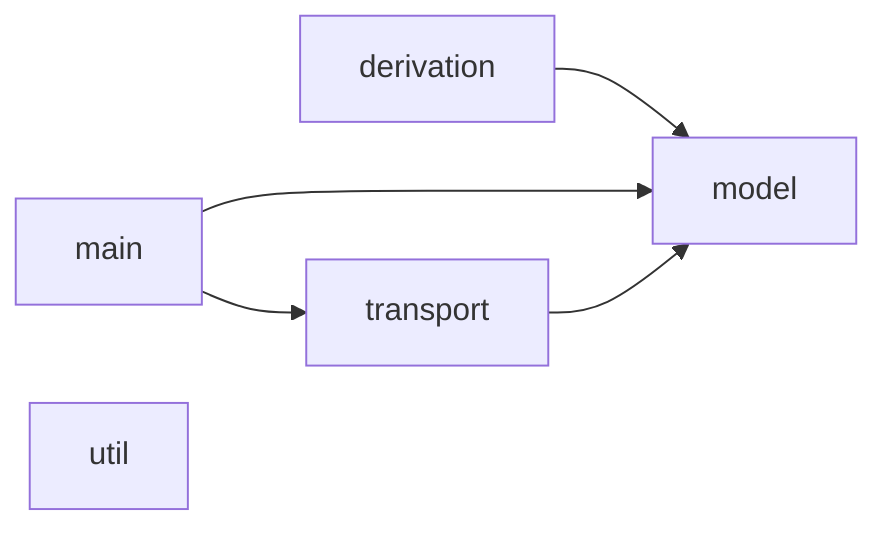

# keg

A small web framework, merging ideas from
[flask](https://flask.palletsprojects.com/en/stable/),
[rocket](https://rocket.rs/) and especially reusing many ideas from
[cask](https://github.com/com-lihaoyi/cask).

[include:simple]

Keg aims to make writing HTTP applications in Scala a breeze. It is designed for
writing full classic web apps or specialized application programming interfaces
(APIs) alike. It includes most features you'd expect in a web server, yet stays
minimal and strives to make development fun. It should feel ergonomic and not
impose how you build your application.

Keg is NOT a full-featured framework, which imposes an application structure,
such as Django or Play! You can use it as a library if you like.

## Differences with cask

Given the name "Keg" is a nod to "Cask", there is no surprise that it resembles
the latter. Keg started out as a heavily customized version of cask, which I
used internally for some services, and ended up ripping out. What you see here
is essentially that, cleaned up a little.

This repository serves to showcase some ideas of keg. It may be possible to
upstream changes back into cask (although it would change many core cask APIs).

The original cask customizations were the following:

- Keg's focus is around extensible request-scoped state (e.g. adding the logged
  in user to a request, or checking authorization).

  - Defining cask decorators as member types of a configuration trait and making
    input parsing path-dependent. This gave me an easy way to define typeclasses
    for various parameter types.

- A server available under scalanative

These then led to a more. [See here](./cask-diff.md) for a description of most
changes and their rationales.

## Feature overview

- [Basics](#basics)
- [Request routing](#request-routing)
- [Reading request data](#reading-request-data)
- [Returning responses](#returning-responses)
- [Configuration traits](#configuration-traits)
- [Managing state and structuring application](#managing-state-and-structuring-application)
- [Error handling](#error-handling)
- [Websockets](#websockets)
- [Cookies, session, and flash data](#cookies-session-and-flash-data)
- [TLS and mTLS](#tls-and-mtls)
- [Raw endpoints](#raw-endpoints)
- [Interceptors](#interceptors)
- [Transports](#transports)
- [Forms](#forms)
- [JSON](#json)

### Basics

[include:basics]

### Request routing

[include:routing]

### Reading request data

[include:types]

### Returning responses

[include:responsetypes]

### Configuration traits

[include:configtraits]

### Managing state and structuring application

[include:state]

### Error handling

[include:errors]

### Websockets

[include:websockets]

### Cookies, session, and flash data

[include:sessionflash]

### TLS and mTLS

[include:tls]

### Raw endpoints

[include:endpoints]

### Interceptors

[include:interceptors]

### Transports

Keg itself does not implement the actual handling of network requests. Instead,
it factors those out to so-called *transports*. A transport is the subsystem
which handles the low-level reading and writing of network streams which make up
the HTTP protocol.

Keg is structured in such a way that the transport for a keg server can be
swapped out. Or, put differently, you can essentially think of keg as being a
large wrapper around a transport, which does that actual request handling.

Out-of-the-box, keg comes with two transports:

1. one based on the Undertow webserver. This is a very stable and
   feature-complete webserver for Java. Unfortunately however, it does not work
   with ScalaNative and also has issues when built as a GraalVM native image.

   This transport is the **default when using keg on the JVM**.

1. one based on an experimental pure-scala HTTP server written from scratch.
   This webserver is minimal, doesn't implement advanced features such as
   websockets, and is probably not spec-compliant (web clients should be
   tolerant). It is however available under scala native!

   This transport is the **default when using keg with scala native**.

Here is a more detailed comparison of both transports:

| feature  | UndertowTransport | UhttpTransport |
|----------|-------------------|----------------|
| HTTP/1.1 | yes               | yes            |
| HTTP/2.0 | yes               | no             |
| HTTPS    | yes               | only on JVM    |
| websockets | yes             | no             |
| JVM      | yes               | yes            |
| native   | no                | yes            |

You can switch out the transport simply by passing it as an argument to
`keg.Server`. For example, here we explicitly tell keg to use the Uhttp server,
regardless of platform:

```scala
keg.Server(
  ...,
  transportBuilder = keg.transport.uhttp.UhttpTransport(_, _)
)
```

You can also implement your own transport if you like. Take a look at the
[Transport](keg/transport/Transport.scala) trait to see what you need.

### Forms

[include:forms]

### JSON

[include:json]

## Internals

### Layers

(arrow means "depends on")



- model: scala types that are used to represent things involved in handling HTTP
  requests

- derivation: syntax sugar and macros to allow a user to write "nice" programs

- main: routing logic and higher-level runtime components

- transport: low-level, pluggable implementation of an HTTP server. This is
  primarily made separate so that different backends can exist, for example
  undertow for the JVM, and a custom simplistic server for scalanative

Derivation and model layers are to be considered as library layers, no logging
or side-effecting is allowed; those are reserved for main and transport.


